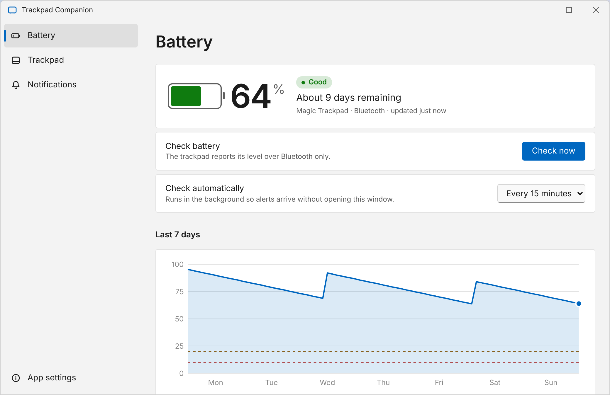
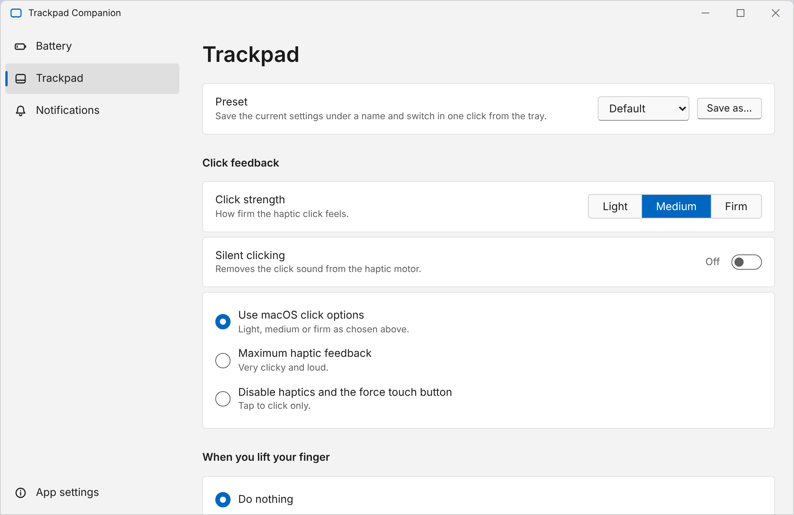
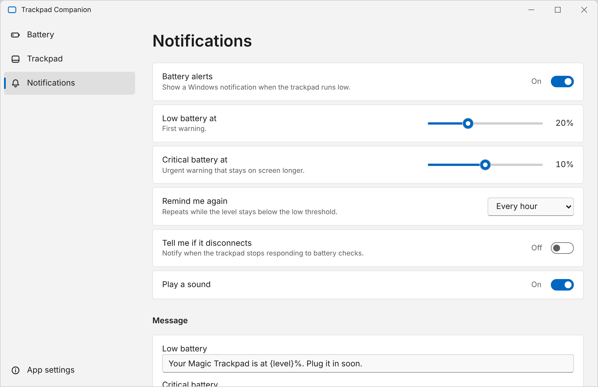
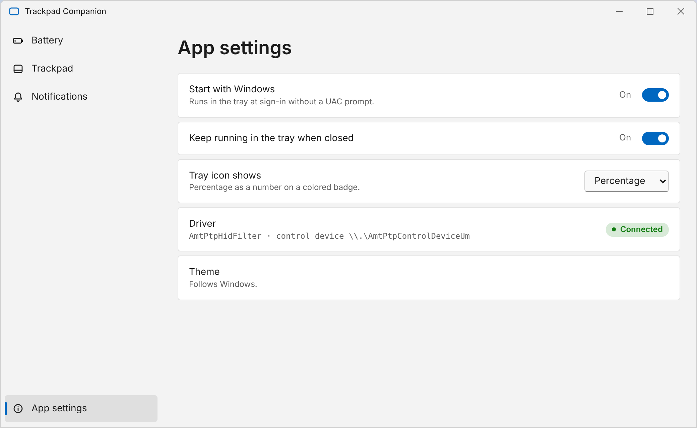
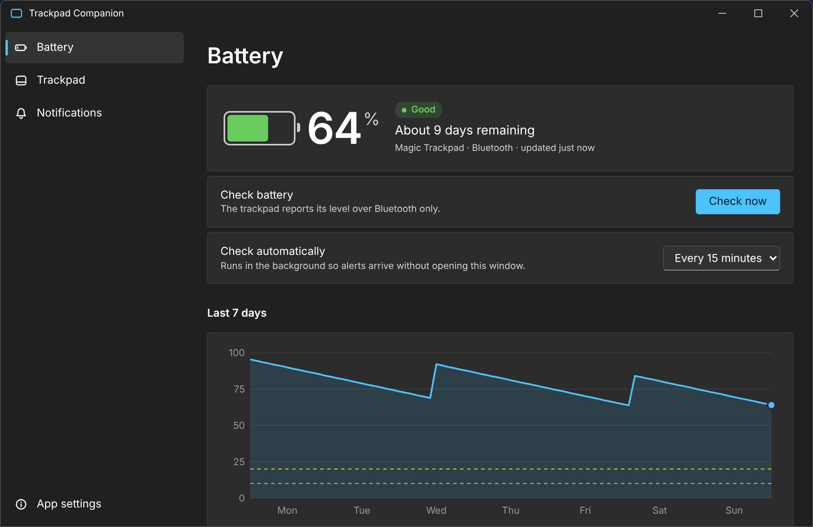

# Trackpad Companion

A Windows 11 settings app and tray monitor for the Apple Magic Trackpad (including the USB-C model) when it runs on the community Precision Touchpad driver.

- **Battery in the tray.** Checks the trackpad on a schedule and shows the percentage on the tray icon. It turns orange and red as the battery drops.
- **Low-battery alerts.** Windows notifications at levels you choose, with repeat reminders, a disconnect alert and your own message text.
- **Battery history.** A 7-day chart and a time-remaining estimate.
- **Trackpad settings.** Click strength, silent clicking, haptics mode, pointer stop rules and palm rejection, with named presets you can switch from the tray menu.

> **Status: early version.** The app builds and starts, but it has had little testing on real hardware. Expect rough edges and please open an issue with `%APPDATA%\TrackpadCompanion\app.log` attached if something breaks.

## About

Trackpad Companion is a front end for the [Magic Trackpad 2 for Windows](https://github.com/vitoplantamura/MagicTrackpad2ForWindows) driver by Vito Plantamura, which is itself a fork of [imbushuo/mac-precision-touchpad](https://github.com/imbushuo/mac-precision-touchpad). The driver is what makes the trackpad work as a precision touchpad. This app replaces that project's control panel with a modern window, a battery tray icon and alerts. It does not contain the driver. The installer downloads it from the driver's own release page.

## Screenshots

These are from the design mockup ([`docs/ui-mockup.html`](docs/ui-mockup.html)) with sample data. They show the intended look. The real app is built with WinUI 3 and may differ in detail.

| Battery | Trackpad |
| --- | --- |
|  |  |

| Notifications | App settings |
| --- | --- |
|  |  |

Dark theme: 

## Languages

English, Français, Deutsch, Español, 日本語, 简体中文, Polski, Русский, Português (Brasil) and Afrikaans. The app follows the Windows display language by default. Pick a language under **App settings → Language** (applies after a restart). The installer also follows the Windows language. The translations are machine-written and have not been reviewed by native speakers, so corrections are welcome. The strings are in [`src/Lang`](src/Lang), one JSON file per language.

## Requirements

- Windows 11, 64-bit. Windows 10 1809 or later can run the app, but the driver's author ships a different package for Windows 10, so check the [driver page](https://github.com/vitoplantamura/MagicTrackpad2ForWindows) first.
- A Magic Trackpad 2 or the USB-C Magic Trackpad (the driver covers the USB-C model, PID 0x0324, over Bluetooth)
- Battery level is only available over Bluetooth. The driver cannot read it over USB.

## Install

1. Download `TrackpadCompanion-Setup-<version>.exe` from the [Releases](../../releases) page and run it.
2. Leave **Download and install the Magic Trackpad driver** ticked if you do not already have the driver. The installer downloads it from its author's release page, checks its signature, and installs it with `pnputil`.
3. Pair the trackpad in **Settings → Bluetooth & devices**, then open Trackpad Companion.

The installer asks for administrator rights because the driver's control device only opens for administrators. Ticking **Start Trackpad Companion in the tray when I sign in** creates a scheduled task that runs at sign-in with the right privileges and no UAC prompt.

A portable zip is also on the release page. Unzip it anywhere and run `TrackpadCompanion.exe`. It does not install the driver.

### Before you install the driver

Remove anything else that drives this trackpad, or the two will fight over it: Apple Boot Camp drivers, Magic Utilities, Trackpad++, and any older precision-touchpad driver. Use Device Manager (tick **Delete the driver software for this device**) or DriverStore Explorer.

### Installing the driver by hand

Download `MT2FW11-<date>-MSSigned.zip` from the [driver releases](https://github.com/vitoplantamura/MagicTrackpad2ForWindows/releases), unzip it, open the `AMD64` folder, right-click `AmtPtpDevice.inf` and choose **Install**.

## Build from source

You need the .NET 8 SDK (`winget install Microsoft.DotNet.SDK.8`).

```powershell
git clone https://github.com/Tri-Lumen/Magic-Trackpad-GUI.git
cd Magic-Trackpad-GUI
.\scripts\build-local.ps1
.\publish\TrackpadCompanion.exe
```

To build the installer, install [Inno Setup 6](https://jrsoftware.org/isinfo.php), then run:

```powershell
iscc /DAppVersion=1.0.0 installer\TrackpadCompanion.iss
```

GitHub Actions builds both on every push. Pushing a tag such as `v1.0.0` publishes a release with the installer and the portable zip attached.

## How it works

The driver registers a control device, `\\.\AmtPtpControlDeviceUm`. The app opens it as administrator and sends two requests:

| Request | Code | Result |
| --- | --- | --- |
| Get battery | `0x222004` | 4-byte percentage, valid when 0–100 |
| Reload settings | `0x222000` | none |

Settings live as DWORD values under `HKLM\SOFTWARE\Microsoft\Windows NT\CurrentVersion\WUDF\Services\AmtPtpDeviceUsbUm\Parameters` and `HKLM\SYSTEM\CurrentControlSet\Services\AmtPtpHidFilter\Parameters`: `ButtonDisabled`, `FeedbackClick`, `FeedbackRelease`, `StopPressure`, `StopSize`, `IgnoreButtonFinger`, `IgnoreNearFingers` and `PalmRejection`. Applying settings writes them, restarts the touchpad device and asks the driver to reload.

Alerts use the notification-area balloon API instead of the newer app notification API, because the newer one does not work in an elevated process.

## Uninstall

Use **Settings → Apps**. This removes the app and its startup task. The driver stays installed; remove it in Device Manager (the "Apple Precision Touch Device", "Apple Multi-touch Trackpad HID Filter" and "Apple Multi-touch Auxiliary Services" entries, with **Delete the driver software** ticked).

User data is in `%APPDATA%\TrackpadCompanion` (settings, presets, battery history, `app.log`).

## Credits and licenses

Trackpad Companion is [MIT licensed](LICENSE). The driver is a separate GPL-2.0 project by Bingxing Wang, Vito Plantamura and contributors, and is not part of this repository. See [THIRD-PARTY.md](THIRD-PARTY.md). Apple and Magic Trackpad are trademarks of Apple Inc. This project is not affiliated with Apple.
